# Nothing gets unseen: my home lab
 
A firewall, an attacker, a vulnerable web server and a network sensor, segmented into three zones and running on one 8 GB laptop. Every attack crosses the firewall and is recorded four ways.
 
Want to build it yourself? Step-by-step commands are in [SETUP.md](SETUP.md).
 
## Overview
 
A segmented VirtualBox lab where every attack has to cross a firewall and is recorded by a dedicated network sensor. Four VMs run on a Lenovo Legion 5 Pro with 8 GB of RAM, stored on an external Seagate HDD.
 
| Skill area                    | Covered by                                               | Status  |
|-------------------------------|----------------------------------------------------------|---------|
| Network traffic analysis      | Zeek, tcpdump and Wireshark on sensor01                  | Built   |
| Intrusion detection           | Suricata with the ET Open ruleset (53,571 enabled rules) | Built   |
| Firewall                      | OPNsense rules, NAT and firewall logs                    | Built   |
| Web attacks                   | DVWA on web01                                            | Built   |
| Active Directory and identity | Existing AD VMs joined to CORP                           | Planned |
| Vulnerability management      | Scanner run against web01                                | Planned |
| SIEM                          | Splunk ingesting firewall, Zeek, Suricata and host logs  | Planned |
 
With 8 GB of host RAM, VMs are powered on per scenario instead of all at once: all four only during an attack, then only sensor01 for the investigation.
 
## Architecture
 

Kali sits alone in ATTACK, so any traffic it sends to CORP is routed and logged by OPNsense; sensor01 captures everything on CORP.
 
## How an attack becomes evidence
 
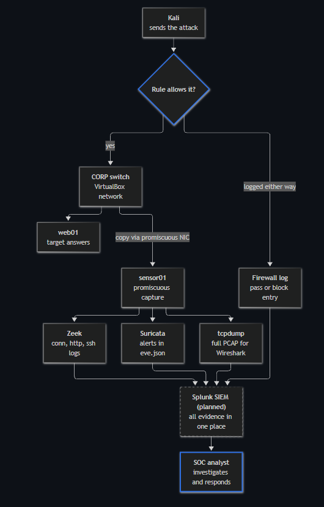
The firewall logs every decision, pass or block. Anything that reaches CORP is also copied to sensor01, where Zeek, Suricata and tcpdump each record it in their own way.
 
## Network and IP plan
 
Three zones meet only at the OPNsense firewall, which is the default gateway and DHCP server for both internal networks.
 
| Zone   | Subnet         | Gateway    | OPNsense interface           | DHCP pool                  | Purpose                     |
|--------|----------------|------------|------------------------------|----------------------------|-----------------------------|
| WAN    | VirtualBox NAT | VirtualBox | em0 (WAN), 10.0.2.15 by DHCP | None                       | Internet access for the lab |
| CORP   | 10.0.10.0/24   | 10.0.10.1  | em1 (LAN)                    | 10.0.10.100 to 10.0.10.200 | Targets and the sensor      |
| ATTACK | 10.0.20.0/24   | 10.0.20.1  | em2 (OPT1)                   | 10.0.20.100 to 10.0.20.200 | Attacker                    |
 
DHCP reservations (Dnsmasq host entries) keep each lab machine on one address, so commands, rules and logs always refer to the same IP.
 
| Host     | IP          | MAC               | Reservation |
|----------|-------------|-------------------|-------------|
| web01    | 10.0.10.184 | 08:00:27:62:31:7b | Added       |
| kali     | 10.0.20.180 | 08:00:27:c3:fb:76 | Added       |
| sensor01 | 10.0.10.158 | 08:00:27:36:2a:c1 | To add      |
 
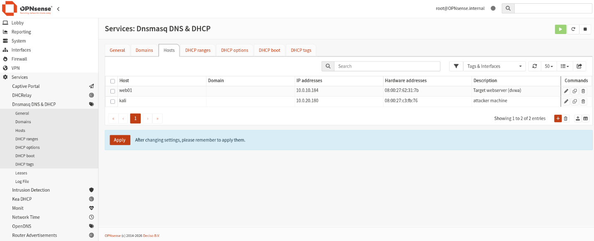
*Figure 1: Dnsmasq host entries pinning web01 and kali to fixed addresses.*
 
VirtualBox Internal Networks named CORP and ATTACK act as the two switches. Neither is reachable from the Windows host or the home network.
 
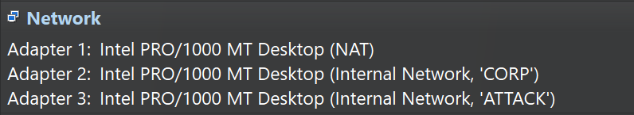
*Figure 2: The firewall VM's three adapters: NAT, CORP and ATTACK.*
 
## Machine inventory
 
Four VMs, each named after its role, so a hostname in any log says what the machine does.
 
| VM   | OS                                       | Role                                                 | Zone                         | IP                          | RAM                        | Disk       |
|----------|----------------------------------------------|----------------------------------------------------------|----------------------------------|---------------------------------|--------------------------------|----------------|
| OPNsense | OPNsense 26.7 (FreeBSD)                      | Firewall, router, NAT, DHCP and DNS (Dnsmasq)            | WAN, CORP, ATTACK                | 10.0.2.15, 10.0.10.1, 10.0.20.1 | 1 GB (3 GB during install)     | 16 GB          |
| kali     | Kali Linux 2026.3, prebuilt VirtualBox image | Attacker                                                 | ATTACK                           | 10.0.20.180                     | 1.5 GB                         | Prebuilt image |
| web01    | Ubuntu Server 26.04.1 LTS                    | Target: Apache 2.4.66, PHP 8.5.4, MariaDB, DVWA, OpenSSH | CORP                             | 10.0.10.184                     | 768 MB (1.5 GB during install) | 25 GB          |
| sensor01 | Ubuntu Server 26.04.1 LTS                    | Network sensor: Zeek 9.0.1, Suricata 8.0.3, tcpdump      | CORP, promiscuous mode Allow All | 10.0.10.158                     | 1.5 GB                         | 25 GB          |
 
Both Ubuntu servers run headless (no desktop) to save RAM. Suricata alone uses about 420 MB with the full ruleset loaded, so sensor01 stays at 1.5 GB. Logins are kept in private notes, not in this doc.
 
## 1. Firewall (OPNsense)
 
1.  Created a VM with three Intel PRO/1000 adapters: Adapter 1 NAT, Adapter 2 Internal Network CORP, Adapter 3 Internal Network ATTACK. FreeBSD names them em0, em1 and em2.
2.  Installed OPNsense 26.7 from the DVD ISO onto the 16 GB virtual disk (ada0) with UFS.
3.  Assigned interfaces from the console: WAN = em0, LAN = em1, OPT1 = em2.
4.  Set LAN to 10.0.10.1/24 and OPT1 to 10.0.20.1/24, each with a DHCP pool of .100 to .200.
5.  Verified the console showed all three interfaces with their addresses.
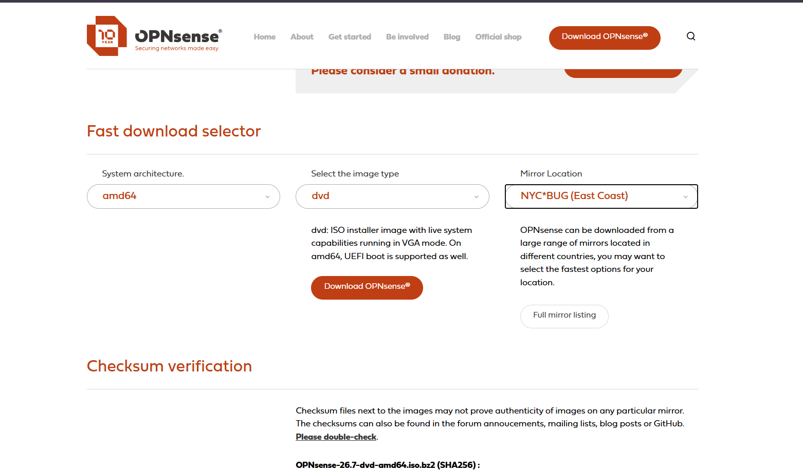
*Figure 3: Downloading OPNsense: amd64 architecture, DVD image.*
 
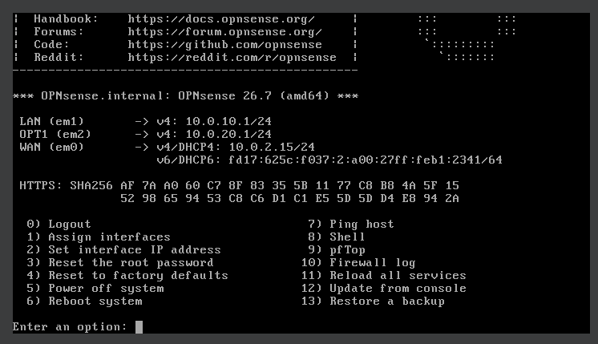
*Figure 4: OPNsense console after setup: LAN 10.0.10.1, OPT1 10.0.20.1, WAN 10.0.2.15 by DHCP.*
 
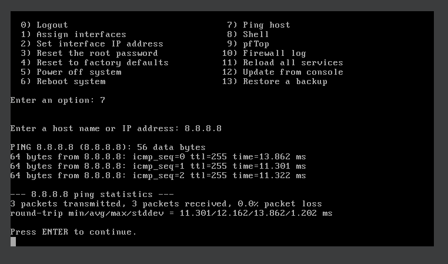
*Figure 5: First ping from the firewall to 8.8.8.8: 3 of 3 replies.*
 
## 2. Attacker (Kali)
 
1.  Imported the prebuilt Kali VirtualBox image and attached it to the ATTACK network.
2.  Added OPT1 to the Dnsmasq interface list so the ATTACK side hands out addresses. Kali received 10.0.20.180.
## 3. Target (web01)
 
1.  Installed Ubuntu Server 26.04.1 on the CORP network with OpenSSH. It received 10.0.10.184.
2.  Installed the web stack: apache2 mariadb-server php php-mysqli php-gd libapache2-mod-php git.
3.  Cloned DVWA from github.com/digininja/DVWA into /var/www/html/dvwa and created its config from config.inc.php.dist.
4.  Created the dvwa database and user, gave Apache (www-data) ownership of the files, and enabled allow_url_include for the file inclusion module.
5.  Verified with curl -I http://localhost/dvwa/ (HTTP 302 to login.php), ran the DVWA setup page and set the security level to Low.
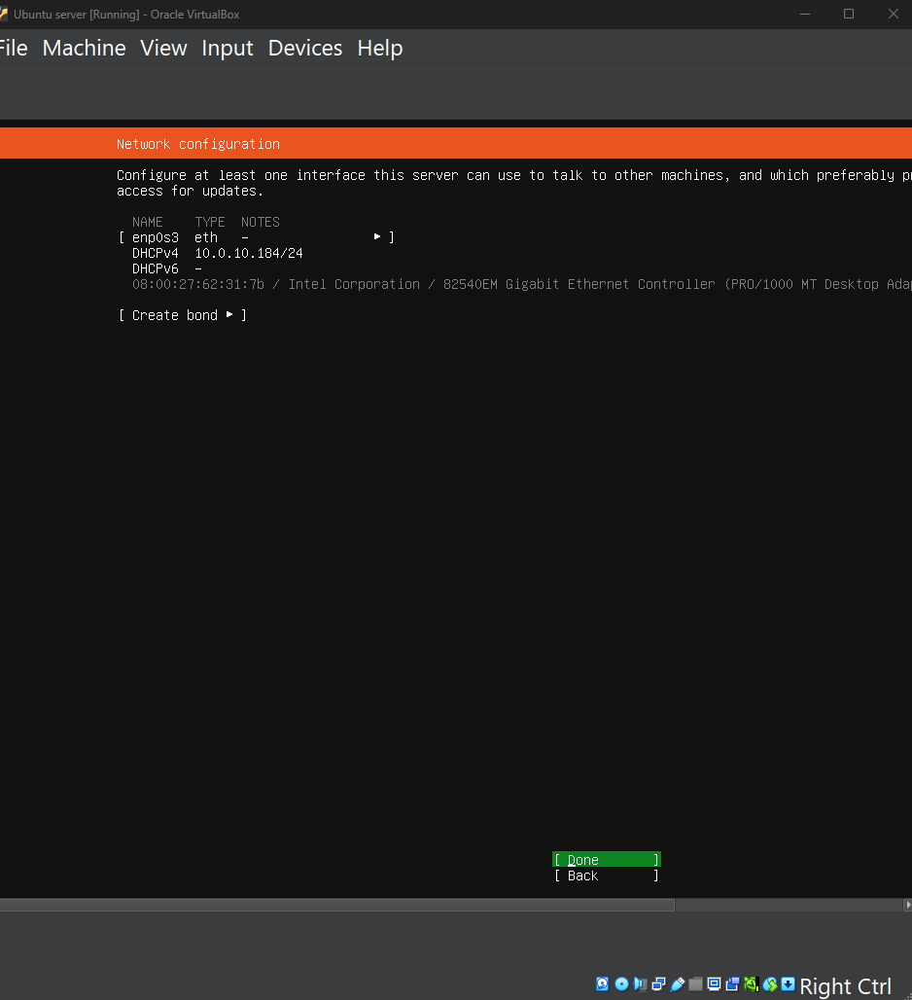
*Figure 6: web01 receiving 10.0.10.184 from OPNsense's DHCP during install.*
 
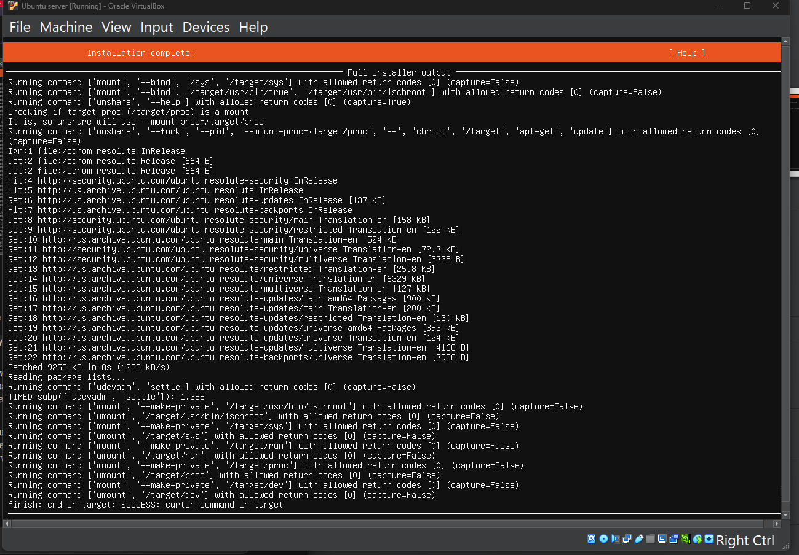
*Figure 7: Ubuntu install complete, with updates downloaded from security.ubuntu.com through the firewall.*
 
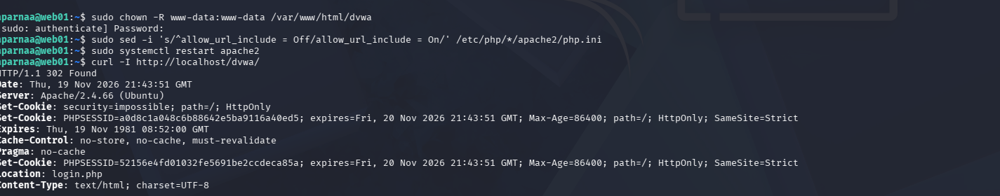
*Figure 8: DVWA answering with HTTP 302, redirecting to login.php.*
 
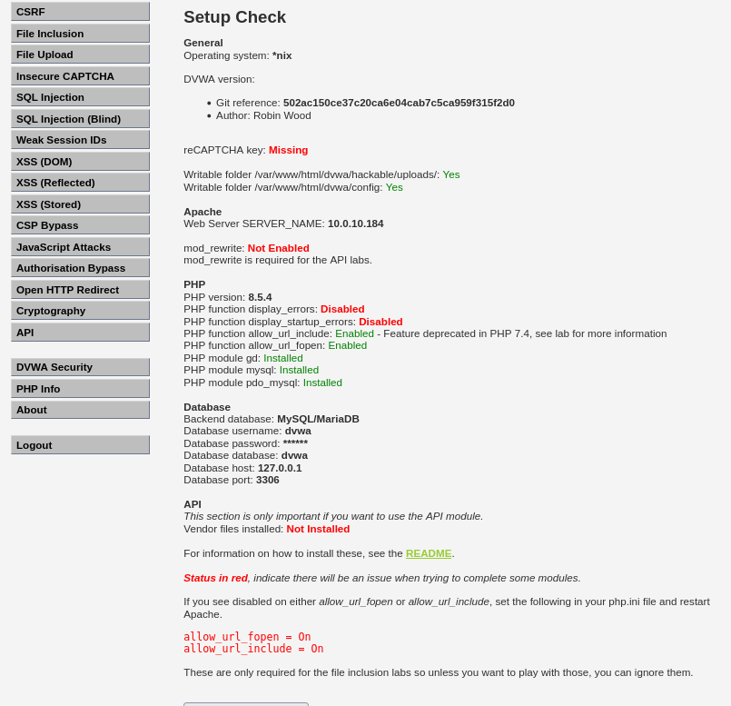
*Figure 9: DVWA setup check: writable folders, PHP modules and the database all ready.*
 

*Figure 10: DVWA login page served from web01.*
 
## 4. Sensor (sensor01)
 
1.  Installed Ubuntu Server 26.04.1 on CORP with the adapter's promiscuous mode set to Allow All, the virtual equivalent of a SPAN port.
2.  Installed Suricata 8.0.3 from Ubuntu's repository.
3.  Installed Zeek 9.0.1 from Zeek's official openSUSE Build Service repository for Ubuntu 26.04, since Ubuntu does not package it.
4.  Configured Zeek: interface enp0s3 in /opt/zeek/etc/node.cfg, JSON logs, deployed with zeekctl deploy, and a cron job running zeekctl cron every 5 minutes so Zeek restarts after a reboot.
5.  Configured Suricata: downloaded the ET Open ruleset with suricata-update (69,546 rules, 53,571 enabled), set the capture interface to enp0s3 and HOME_NET to 10.0.10.0/24.
6.  Verified Zeek was writing conn.log and Suricata was active (running).

*Figure 11: sensor01 receiving 10.0.10.158 on CORP.*
 

*Figure 12: Zeek pointed at enp0s3, switched to JSON logs and deployed: status running.*
 

*Figure 13: Zeek's first conn.log record: sensor01 syncing its clock (NTP, UDP 123).*
 
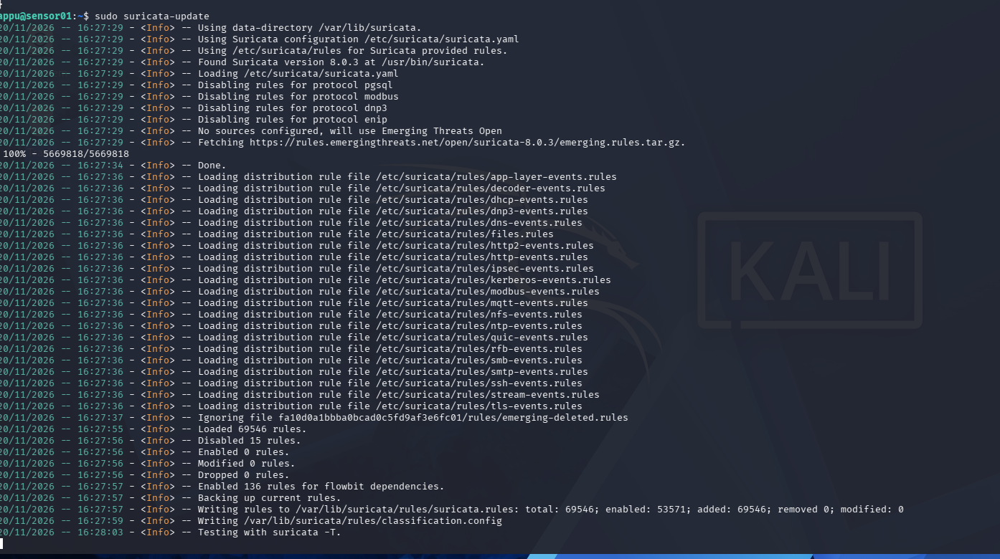
*Figure 14: suricata-update fetching the ET Open ruleset: 69,546 rules, 53,571 enabled.*
 
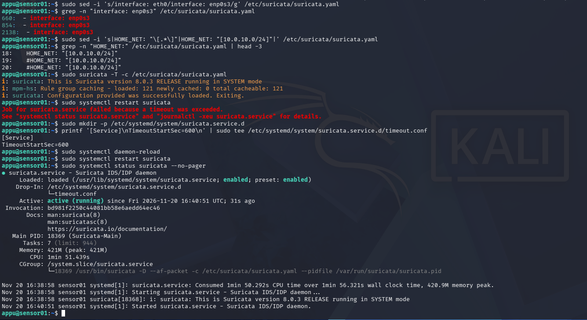
*Figure 15: Suricata active (running) after the startup-timeout fix.*
 
## Firewall configuration and evidence
 
OPT1 (ATTACK) started with no rules, so OPNsense's default deny dropped all of Kali's traffic until one logged allow rule was added.
 
### Before the rule: default deny
 
A curl https://10.0.10.1 from Kali hung with no reply. The firewall's Live View, filtered on the source 10.0.20.180, showed why:
 

*Figure 16: Kali on ATTACK with 10.0.20.180; curl to the firewall hangs with no reply.*
 
| Interface | Direction | Source        | Destination | Protocol | Action | Rule label                      |
|---------------|---------------|-------------------|-----------------|--------------|------------|-------------------------------------|
| OPT1          | In            | 10.0.20.180:44754 | 10.0.10.1:443   | TCP          | block      | Default deny / state violation rule |
 
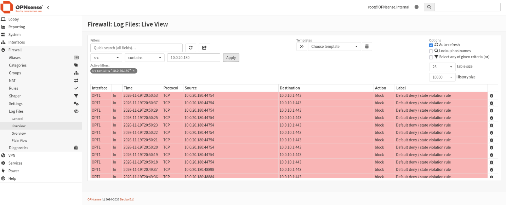
*Figure 17: Firewall Live View: every packet from 10.0.20.180 blocked by the default deny rule.*
 
The same source port repeated at growing intervals (about 1, 2, 4, 8 and 16 seconds apart): TCP retransmissions of a single SYN that the firewall silently dropped. A drop gives the client no reply, which is why curl hung instead of failing.
 
### The allow rule
 
| Setting    | Value                                                |
|----------------|----------------------------------------------------------|
| Interface      | OPT1                                                     |
| Action         | Pass, quick                                              |
| Direction      | In                                                       |
| TCP/IP version | IPv4                                                     |
| Protocol       | Any                                                      |
| Source         | OPT1 network (anti-spoofing: only real ATTACK addresses) |
| Destination    | Any                                                      |
| Log            | Yes                                                      |
| Description    | ATTACK - allow all (lab baseline)                        |
 

*Figure 18: The allow rule on OPT1: pass, source OPT1 network, logging on.*
 

*Figure 19: The rule list with the new ATTACK baseline rule beside the default LAN rules.*
 
### After the rule: verification from Kali
 
| Target  | Result | TTL | What it proves                                          |
|-------------|------------|---------|-------------------------------------------------------------|
| 10.0.20.1   | Reply      | 64      | Kali reaches its gateway                                    |
| 10.0.10.184 | Reply      | 63      | Traffic crosses the firewall into CORP (one hop subtracted) |
| 8.8.8.8     | Reply      | 254     | NAT to the internet works                                   |
 

*Figure 20: Kali reaching the firewall (TTL 64), web01 (TTL 63) and the internet.*
 
The allow-all rule is a lab baseline. Later exercises tighten it (for example, blocking SSH from ATTACK) to practice blocking and containment.
 
## Troubleshooting log
 
Twelve problems came up during the build. Each was isolated to one cause before fixing it. Newest first.
 
| Date | Problem                                                   | Root cause                                                                                                                            | Fix                                                                         |
|----------|---------------------------------------------------------------|-------------------------------------------------------------------------------------------------------------------------------------------|---------------------------------------------------------------------------------|
| Nov 20   | Suricata test alert never fired                               | The testmynids.org test domain had expired and now serves a parked page; the sensor's own outbound traffic is also unreliable for testing | Test with traffic arriving at the sensor instead (a custom ICMP rule, planned)  |
| Nov 20   | systemctl restart suricata failed with a timeout              | Loading 53,571 rules took about 1 min 53 s, longer than systemd's 90 s default                                                            | Drop-in override TimeoutStartSec=600 in /etc/systemd/system/suricata.service.d/ |
| Nov 20   | Zeek's own outgoing packets showed orig_pkts: 0 and history C | Checksum offloading: the sensor captures its own packets before the NIC fills in the checksum                                             | redef ignore_checksums = T; in local.zeek                                       |
| Nov 20   | ls /opt/zeek/logs/current gave Permission denied              | Zeek runs as root, so its logs belong to root                                                                                             | Read logs with sudo; restricted log access is intended                          |
| Nov 20   | apt install zeek found no package                             | Ubuntu 26.04 does not package Zeek                                                                                                        | Added Zeek's official repository and signing key                                |
| Nov 19   | Copy-paste did not work in the web01 console                  | No desktop, so no VirtualBox shared clipboard                                                                                             | Ran commands over SSH from Kali, which has a clipboard                          |
| Nov 19   | Netplan file was not the expected name                        | The installer wrote 00-installer-config.yaml                                                                                              | Chose a DHCP reservation instead of editing netplan                             |
| Nov 19   | OPNsense rejected the MAC address                             | VirtualBox doubled each colon as it was typed (08::00::…)                                                                                 | Retyped slowly and checked the field, or copied the MAC from the Leases page    |
| Nov 19   | Kali got no IP on ATTACK but did on CORP                      | Dnsmasq listened only on LAN; the OPT1 range existed but was never served                                                                 | Added OPT1 to Dnsmasq's Interface field                                         |
| Nov 19   | Firefox could not open the web interface                      | The address was typed without https://, so Firefox used port 80                                                                           | Used https://10.0.10.1                                                          |
| Nov 18   | OPNsense install looped back to the installer menu            | The installer needs about 3 GB of RAM to copy files; the VM had 1 GB                                                                      | Raised the VM to 3 GB for the install, then back to 1 GB                        |
| Nov 18   | The installer offered to install onto the ISO                 | cd0 (the installer disc) was preselected instead of ada0                                                                                  | Selected ada0, then removed the ISO before the first boot                       |
 

*Figure 21: Suricata's first restart failing with a systemd timeout.*
 

*Figure 22: OPNsense rejecting the MAC address entry with "Invalid MAC address".*
 
## Design decisions
 
Each choice trades realism against the 8 GB RAM limit; the lab favours realism wherever it still fits.
 
| Decision       | Chosen                       | Instead of                | Why                                                                                                                          |
|--------------------|----------------------------------|-------------------------------|----------------------------------------------------------------------------------------------------------------------------------|
| Firewall           | OPNsense                         | pfSense, plain Linux iptables | Direct ISO download (pfSense now goes through Netgate's online installer); real rules, logs and built-in Suricata on 1 GB of RAM |
| Segmentation       | Separate ATTACK and CORP subnets | One flat network              | Every attack must cross the firewall and is logged there; the TTL drop from 64 to 63 confirms the extra hop                      |
| VM networking      | VirtualBox Internal Networks     | Bridged or host-only          | Vulnerable machines and live attacks stay off the home network                                                                   |
| Sensor placement   | Dedicated sensor01 VM            | Zeek and Suricata on web01    | Sees all of CORP (including future AD VMs), and its logs survive if web01 is compromised                                         |
| Traffic visibility | Promiscuous mode Allow All       | Default (Deny)                | The virtual equivalent of a SPAN port: the sensor receives traffic not addressed to it                                           |
| Network tools      | Zeek and Suricata                | Snort                         | Zeek writes the connection logbook, Suricata raises signature alerts; Snort would duplicate Suricata                             |
| HOME_NET           | CORP only (10.0.10.0/24)         | Both internal subnets         | Kali counts as external, so rules written for EXTERNAL_NET to HOME_NET fire on lab attacks                                       |
| Zeek log format    | JSON                             | Zeek's default TSV            | Splunk parses JSON fields without extra configuration                                                                            |
| Fixed addresses    | DHCP reservations in OPNsense    | Static IPs set on each host   | Addresses are managed centrally, and nothing on the hosts needs editing                                                          |
| Servers            | Ubuntu Server, headless          | Ubuntu Desktop                | Runs in 768 MB to 1.5 GB instead of about 4 GB                                                                                   |
| DVWA level         | Low                              | Medium, High, Impossible      | Clean attack traffic for learning detection; higher levels later test whether detections survive obfuscation                     |
 
