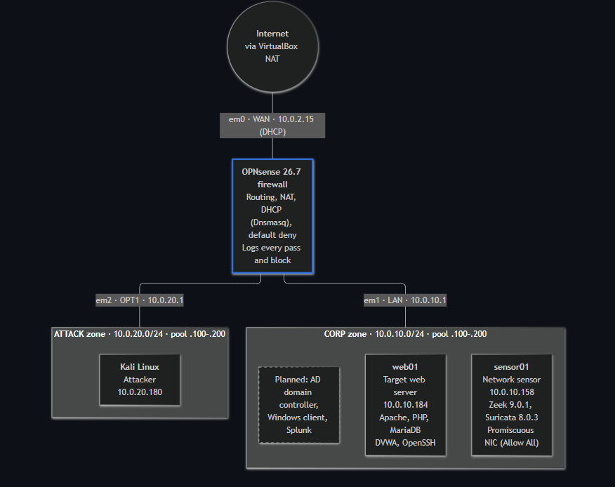
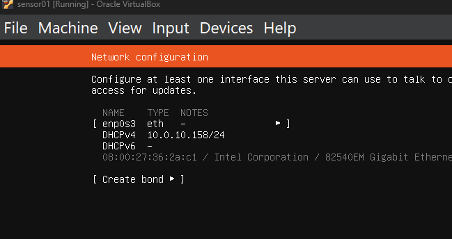
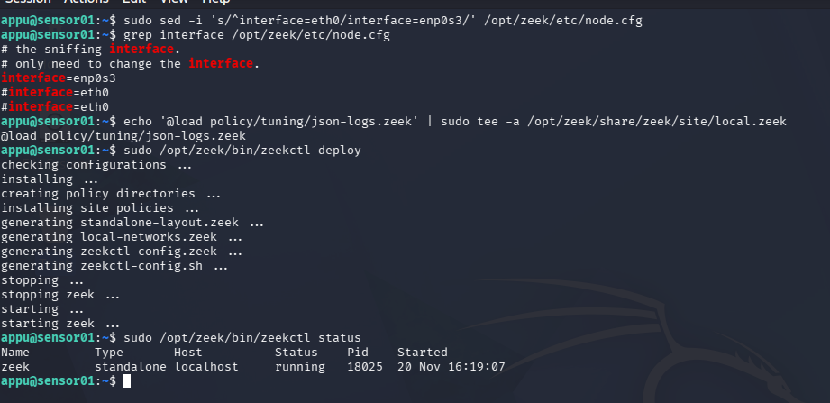
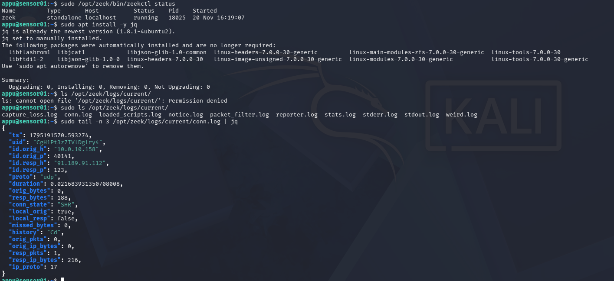
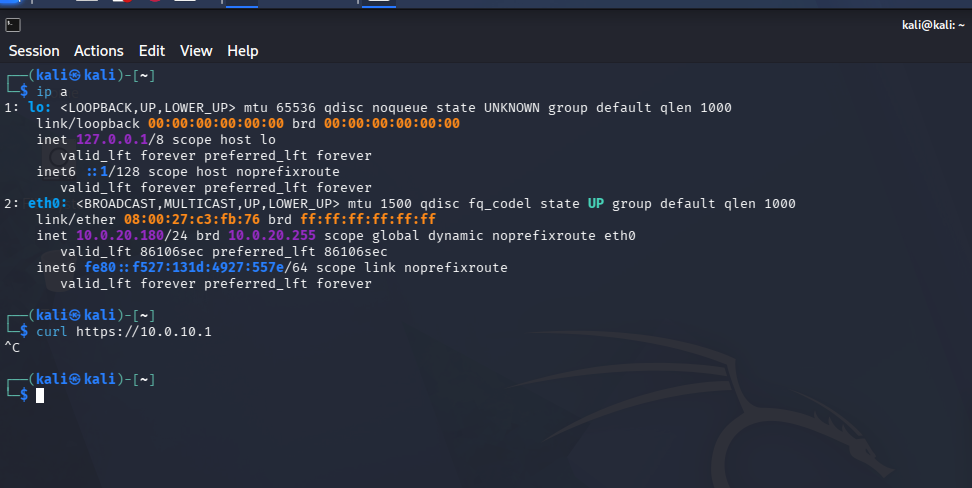
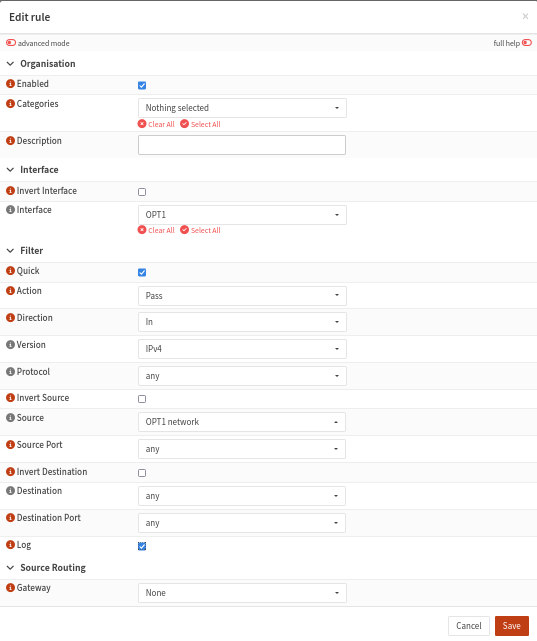
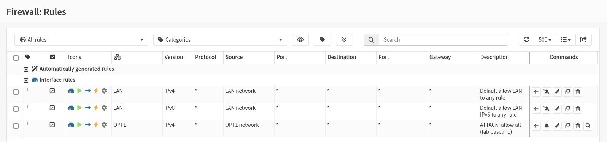
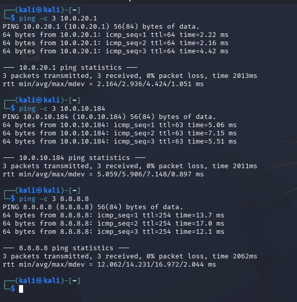
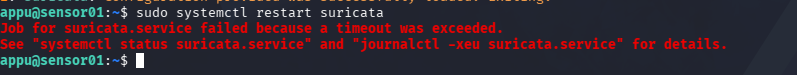
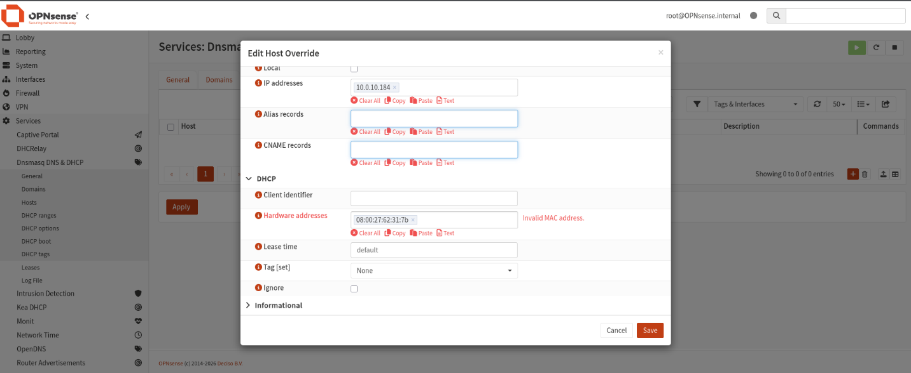

<p align="center">
  
</p>

<p align="center">
  
  
  
  
  
  
  
</p>

<p align="center">
  <b>A firewall, an attacker, a vulnerable web server and a network sensor,<br>split into three networks on one 8 GB laptop. Every attack leaves four pieces of evidence behind.</b>
</p>

<p align="center">
  <a href="#in-one-minute">Overview</a> ·
  <a href="#the-design">Design</a> ·
  <a href="#step-0-before-you-start">Build it yourself</a> ·
  <a href="#step-5-write-the-first-firewall-rule">The proof</a> ·
  <a href="#troubleshooting-log">Troubleshooting</a> ·
  <a href="#whats-next">What's next</a>
</p>

<div align="center">
<table>
  <tr>
    <td align="center"><h3>4</h3><sub>virtual machines</sub></td>
    <td align="center"><h3>3</h3><sub>isolated networks</sub></td>
    <td align="center"><h3>53,571</h3><sub>detection rules</sub></td>
    <td align="center"><h3>12</h3><sub>problems solved</sub></td>
    <td align="center"><h3>8 GB</h3><sub>of RAM, total</sub></td>
    <td align="center"><h3>3 days</h3><sub>to build</sub></td>
  </tr>
</table>
</div>

---

## In one minute

I built a small company network inside my laptop, attacked it, and made sure every attack left evidence behind.

- **The attacker** (Kali Linux) sits on its own network, like someone outside the company.
- **The company network** (called CORP) has a deliberately vulnerable website (web01) to attack.
- **A firewall** (OPNsense) sits in between. It is the only path from the attacker to the company, so every attack passes through it and gets logged.
- **A network sensor** (sensor01, running Zeek and Suricata) watches all traffic inside the company network and records it.

Every attack leaves four records: a firewall log entry, Zeek connection logs, Suricata alerts and a full packet capture. That is the evidence a SOC analyst works with every day.

## What this project shows

| Skill | Where to see it |
| --- | --- |
| Designing a segmented network | [The design](#the-design) |
| Building and configuring a firewall | [Step 1](#step-1-build-the-firewall-opnsense) and [Step 5](#step-5-write-the-first-firewall-rule) |
| Reading firewall logs | [Step 5: before the rule](#before-the-rule-default-deny) |
| Deploying a network sensor (Zeek and Suricata) | [Step 4](#step-4-build-the-network-sensor-sensor01) |
| Troubleshooting with limited resources | [Troubleshooting log](#troubleshooting-log) |
| Explaining design choices | [Design decisions](#design-decisions) |

## How to read this

- **Short on time?** Read the section above and look at the two diagrams in [The design](#the-design).
- **Want proof it works?** [Step 5](#step-5-write-the-first-firewall-rule) shows the firewall blocking my attacker, then letting it through once I wrote a rule.
- **Want to build it yourself?** Follow Steps 0 to 5 in order. Each step says what it does, why, how to do it, and how to check it worked.

## Contents

- [The design](#the-design)
- [Step 0: Before you start](#step-0-before-you-start)
- [Step 1: Build the firewall (OPNsense)](#step-1-build-the-firewall-opnsense)
- [Step 2: Add the attacker (Kali)](#step-2-add-the-attacker-kali)
- [Step 3: Build the target web server (web01)](#step-3-build-the-target-web-server-web01)
- [Step 4: Build the network sensor (sensor01)](#step-4-build-the-network-sensor-sensor01)
- [Step 5: Write the first firewall rule](#step-5-write-the-first-firewall-rule)
- [Reference: network plan and machines](#reference-network-plan-and-machines)
- [Troubleshooting log](#troubleshooting-log)
- [Design decisions](#design-decisions)
- [What's next](#whats-next)

---

## The design

### The architecture

<p align="center">
  
</p>

**What you're looking at:**

- **Three networks.** WAN connects the lab to the internet. CORP is the "company" where the targets live. ATTACK is where the attacker lives.
- **One firewall joins them.** OPNsense has one network card in each network. Kali (on ATTACK) and web01 (on CORP) are on different networks, so Kali cannot reach web01 directly. Its traffic has to go to the firewall first, and the firewall checks and logs it.
- **A sensor on CORP.** sensor01's network card is set to receive *all* traffic on CORP, not just traffic meant for it. In a real company, this is done with a switch's SPAN (mirror) port.

### How an attack becomes evidence

<p align="center">
  
</p>

**Follow one attack from top to bottom:**

1. Kali sends an attack toward the company network.
2. The firewall checks its rules. Either way, it **logs** the decision (pass or block). That's evidence #1.
3. If allowed, the traffic reaches the CORP network and the target (web01).
4. sensor01 gets a copy of the same traffic and records it three ways:
   - **Zeek** writes a logbook of every connection: who talked to whom, on which port, for how long (evidence #2).
   - **Suricata** compares traffic against 53,571 known attack patterns and raises an alert on a match (evidence #3).
   - **tcpdump** saves the raw packets so they can be opened in Wireshark (evidence #4).
5. Later, all of this goes into Splunk (planned), where an analyst investigates.

---

## Step 0: Before you start

**What you need:**

| Item | Details |
| --- | --- |
| Laptop | 8 GB RAM minimum (this whole lab runs on 8 GB) |
| Disk | About 100 GB free (this lab uses an external USB hard disk) |
| VirtualBox | Free, from virtualbox.org |
| OPNsense 26.7 | opnsense.org/download, architecture **amd64**, image type **dvd** |
| Kali Linux | kali.org/get-kali, the prebuilt **VirtualBox** image |
| Ubuntu Server 26.04.1 LTS | ubuntu.com/download/server |
| 7-Zip | To extract the OPNsense `.iso.bz2` and the Kali `.7z` files |

> [!TIP]
> **Running on 8 GB?** Close your browser and other apps while the lab runs, and keep these instructions open on your phone. You only need all four VMs running during an attack.

> [!WARNING]
> DVWA (the target app) is vulnerable on purpose. Keep the lab on VirtualBox **Internal Networks** only, never on a bridged or home network.

---

## Step 1: Build the firewall (OPNsense)

**What I did:** created a firewall VM with three network cards, one for each network, installed OPNsense on it, and gave it an IP address on each internal network.

**Why:** the firewall is the center of the lab. Every other machine gets its IP address from it, and all attack traffic has to pass through it.

### How to do it

**1. Create the VM in VirtualBox** (New):

<details>
<summary><b>Show settings</b></summary>

```
Name:            OPNsense
Type / Version:  BSD / FreeBSD (64-bit)
RAM:             3072 MB for the install (the installer needs it), then 1024 MB
CPU / Disk:      1 / 16 GB
```

</details>

**2. Set up its three network cards** (Settings > Network). The names `CORP` and `ATTACK` must be typed exactly like this, because every other VM connects using the same names:

<details>
<summary><b>Show settings</b></summary>

```
Adapter 1:  NAT                                -> becomes em0 (WAN, internet)
Adapter 2:  Internal Network, name CORP        -> becomes em1 (LAN)
Adapter 3:  Internal Network, name ATTACK      -> becomes em2 (OPT1)
```

</details>

<p align="center">
  <br>
  <em>Figure 1: The firewall VM's three network cards: NAT, CORP and ATTACK.</em>
</p>

**3. Install OPNsense:**

<details>
<summary><b>Show settings</b></summary>

```
1. Start the VM from the OPNsense ISO, log in as:  installer / opnsense
2. Choose Install (UFS), then select the disk ada0 (not cd0, which is the ISO itself)
3. Set a root password, then Complete Install
4. Power off, remove the ISO (Settings > Storage), set RAM back to 1024 MB, start again
```

</details>

<p align="center">
  <br>
  <em>Figure 2: Downloading OPNsense: amd64 architecture, DVD image.</em>
</p>

**4. Assign the network cards and set IPs** (log in as `root`, use the console menu):

<details>
<summary><b>Show settings</b></summary>

```
Option 1 (Assign interfaces):
    LAGGs: n    VLANs: n    WAN: em0    LAN: em1    Optional 1: em2    Proceed: y

Option 2 (Set interface IP address), LAN:
    IPv4 via DHCP: n    Address: 10.0.10.1    Subnet bits: 24    Upstream gateway: (leave blank)
    Enable DHCP server: y    Range: 10.0.10.100 to 10.0.10.200

Option 2 again, OPT1:
    IPv4 via DHCP: n    Address: 10.0.20.1    Subnet bits: 24    Upstream gateway: (leave blank)
    Enable DHCP server: y    Range: 10.0.20.100 to 10.0.20.200
```

</details>

### Check it worked

The console should show all three interfaces with their addresses, and a ping to the internet (console option 7, `8.8.8.8`) should get replies.

<p align="center">
  <br>
  <em>Figure 3: OPNsense console after setup: LAN 10.0.10.1, OPT1 10.0.20.1, WAN 10.0.2.15 from VirtualBox.</em>
</p>

<p align="center">
  <br>
  <em>Figure 4: The firewall's first ping to 8.8.8.8: 3 of 3 replies.</em>
</p>

---

## Step 2: Add the attacker (Kali)

**What I did:** imported Kali, connected it to the ATTACK network, and fixed the firewall's DHCP so Kali could get an IP address there. Then I gave Kali and the web server fixed addresses.

**Why:** Kali needs to sit on its own network so its attacks cross the firewall. Fixed addresses mean the attacker and the target always have the same IP, so commands, rules and logs never point at the wrong machine.

### How to do it

**1. Add Kali to VirtualBox:**

<details>
<summary><b>Show settings</b></summary>

```
VirtualBox: Machine > Add > select the .vbox file from the extracted Kali image
RAM: 1536 MB
Adapter 1: Internal Network, name ATTACK     (Adapters 2 to 4: disabled)
Login: kali / kali
Start OPNsense first, then Kali
```

</details>

**2. Let the firewall hand out IPs on ATTACK.** By default, the DHCP service only listens on LAN, so Kali gets no IP. Open the firewall's web interface at `https://10.0.10.1` from a machine on CORP (you can temporarily switch Kali's network to CORP for this), then:

<details>
<summary><b>Show settings</b></summary>

```
Services > Dnsmasq DNS & DHCP > General
    Interface: select LAN and OPT1 (never WAN) > Save > Apply
```

</details>

**3. Give machines fixed addresses** (DHCP reservations). Find each machine's MAC address with `ip a`:

<details>
<summary><b>Show settings</b></summary>

```
Services > Dnsmasq DNS & DHCP > Hosts > +
    Host: web01    IP: 10.0.10.184    Hardware address: <web01's MAC>
    Host: kali     IP: 10.0.20.180    Hardware address: <kali's MAC>
    Save > Apply
```

</details>

<p align="center">
  <br>
  <em>Figure 5: Fixed addresses for web01 and kali in the firewall's DHCP settings.</em>
</p>

### Check it worked

```bash
sudo systemctl restart NetworkManager   # ask for a new IP
ip a                                    # eth0 should show 10.0.20.x
```

> [!NOTE]
> Kali can't reach anything yet, and that's expected. The firewall blocks all traffic from ATTACK until [Step 5](#step-5-write-the-first-firewall-rule).

---

## Step 3: Build the target web server (web01)

**What I did:** installed Ubuntu Server on the CORP network, then installed DVWA (Damn Vulnerable Web Application), a website that is vulnerable on purpose.

**Why:** the attacker needs something realistic to attack. DVWA has real vulnerabilities (SQL injection, command injection and more), and every attack on it creates network traffic for the sensor to catch.

### How to do it

**1. Create the VM and install Ubuntu Server:**

<details>
<summary><b>Show settings</b></summary>

```
VirtualBox: Type Linux / Ubuntu (64-bit), tick "Skip Unattended Installation"
RAM: 1536 MB for the install, then 768 MB    CPU: 1    Disk: 25 GB
Adapter 1: Internal Network, name CORP

Installer choices:
    Ubuntu Server (not minimized), use the entire disk
    Server name: web01
    Tick "Install OpenSSH server", no extra snaps
```

</details>

<p align="center">
  <br>
  <em>Figure 6: web01 getting 10.0.10.184 from the firewall during the install. This proves it's on CORP.</em>
</p>

<p align="center">
  <br>
  <em>Figure 7: Install complete. The updates came from security.ubuntu.com through the firewall.</em>
</p>

**2. Install DVWA.** The server has no copy-paste, so connect from Kali with `ssh <your-user>@10.0.10.184` and paste these:

<details>
<summary><b>Show commands</b></summary>

```bash
# Update, then install a web server, a database and PHP
sudo apt update && sudo apt upgrade -y
sudo apt install -y apache2 mariadb-server php php-mysqli php-gd libapache2-mod-php git

# Download DVWA and create its config file
cd /var/www/html
sudo git clone https://github.com/digininja/DVWA.git dvwa
sudo cp dvwa/config/config.inc.php.dist dvwa/config/config.inc.php

# Create the database and user that DVWA's config expects
sudo mysql -e "CREATE DATABASE dvwa; CREATE USER 'dvwa'@'localhost' IDENTIFIED BY 'p@ssw0rd'; GRANT ALL ON dvwa.* TO 'dvwa'@'localhost'; FLUSH PRIVILEGES;"

# Let Apache own the files, and turn on the PHP setting DVWA's file inclusion lab needs
sudo chown -R www-data:www-data /var/www/html/dvwa
sudo sed -i 's/^allow_url_include = Off/allow_url_include = On/' /etc/php/*/apache2/php.ini
sudo systemctl restart apache2
```

</details>

**3. Finish in a browser on Kali:**

<details>
<summary><b>Show settings</b></summary>

```
http://10.0.10.184/dvwa/setup.php  >  Create / Reset Database
Log in as admin / password  >  DVWA Security  >  Low  >  Submit
```

</details>

### Check it worked

```bash
curl -I http://localhost/dvwa/    # expect: HTTP/1.1 302 Found, Location: login.php
```

<p align="center">
  <br>
  <em>Figure 8: DVWA answering with HTTP 302, sending visitors to its login page.</em>
</p>

<p align="center">
  <br>
  <em>Figure 9: DVWA's setup check: folders, PHP modules and database all ready.</em>
</p>

<p align="center">
  <br>
  <em>Figure 10: The DVWA login page, served from web01.</em>
</p>

---

## Step 4: Build the network sensor (sensor01)

**What I did:** built a second Ubuntu server on CORP whose network card receives all traffic on that network, then installed Zeek and Suricata on it.

**Why:** this is the "camera" of the lab. Zeek writes down every connection (who, where, when, how much), and Suricata raises an alarm when traffic matches a known attack. Running them on their own machine means they see the whole network, and their logs stay safe even if web01 gets hacked.

### How to do it

**1. Create the VM.** The promiscuous mode setting is what lets it see other machines' traffic:

<details>
<summary><b>Show settings</b></summary>

```
VirtualBox: Type Linux / Ubuntu (64-bit), tick "Skip Unattended Installation"
RAM: 1536 MB (keep it there, Suricata alone uses about 420 MB)    Disk: 25 GB
Adapter 1: Internal Network, name CORP
           Advanced > Promiscuous Mode: Allow All
Installer: same choices as web01, server name sensor01, tick "Install OpenSSH server"
```

</details>

<p align="center">
  <br>
  <em>Figure 11: sensor01 getting 10.0.10.158 on CORP.</em>
</p>

**2. Install Suricata and Zeek:**

<details>
<summary><b>Show commands</b></summary>

```bash
sudo apt update && sudo apt upgrade -y

# Suricata is in Ubuntu's own software repository
sudo apt install -y suricata

# Zeek isn't, so add Zeek's official repository and its signing key first
echo 'deb http://download.opensuse.org/repositories/security:/zeek/xUbuntu_26.04/ /' | sudo tee /etc/apt/sources.list.d/zeek.list
curl -fsSL https://download.opensuse.org/repositories/security:zeek/xUbuntu_26.04/Release.key | gpg --dearmor | sudo tee /etc/apt/trusted.gpg.d/zeek.gpg > /dev/null
sudo apt update
sudo apt install -y zeek    # if a mail setup screen appears, choose No / No configuration

# Zeek installs to /opt/zeek, so add it to the command path
echo 'export PATH=$PATH:/opt/zeek/bin' >> ~/.bashrc
source ~/.bashrc
```

</details>

**3. Set up and start Zeek:**

<details>
<summary><b>Show commands</b></summary>

```bash
# Listen on the CORP network card (Ubuntu calls it enp0s3, check yours with: ip a)
sudo sed -i 's/^interface=eth0/interface=enp0s3/' /opt/zeek/etc/node.cfg

# Write logs as JSON (easy to send to Splunk) and ignore the sensor's own bad checksums
echo '@load policy/tuning/json-logs.zeek' | sudo tee -a /opt/zeek/share/zeek/site/local.zeek
echo 'redef ignore_checksums = T;' | sudo tee -a /opt/zeek/share/zeek/site/local.zeek

# Start Zeek, and restart it automatically after a reboot
sudo /opt/zeek/bin/zeekctl deploy
echo '*/5 * * * * root /opt/zeek/bin/zeekctl cron' | sudo tee /etc/cron.d/zeek
```

</details>

**4. Set up and start Suricata:**

<details>
<summary><b>Show commands</b></summary>

```bash
# Download the free ET Open set of attack signatures
sudo suricata-update

# Listen on enp0s3, and treat only CORP as "home" so Kali counts as an outside attacker
sudo sed -i 's/interface: eth0/interface: enp0s3/g' /etc/suricata/suricata.yaml
sudo sed -i 's|HOME_NET: "\[.*\]"|HOME_NET: "[10.0.10.0/24]"|' /etc/suricata/suricata.yaml

# Loading 53,000+ rules takes about 2 minutes, longer than the default 90-second start limit
sudo mkdir -p /etc/systemd/system/suricata.service.d
printf '[Service]\nTimeoutStartSec=600\n' | sudo tee /etc/systemd/system/suricata.service.d/timeout.conf
sudo systemctl daemon-reload

# Test the configuration, then restart (both take a few minutes)
sudo suricata -T -c /etc/suricata/suricata.yaml
sudo systemctl restart suricata
```

</details>

### Check it worked

```bash
sudo /opt/zeek/bin/zeekctl status                       # expect: running
sudo apt install -y jq
sudo tail -n 3 /opt/zeek/logs/current/conn.log | jq     # Zeek's first records
sudo systemctl status suricata --no-pager               # expect: active (running)
```

<p align="center">
  <br>
  <em>Figure 12: Zeek configured for enp0s3 and JSON logs, deployed and running.</em>
</p>

<p align="center">
  <br>
  <em>Figure 13: Zeek's first record: sensor01 syncing its clock with an internet time server (NTP, UDP port 123).</em>
</p>

<p align="center">
  <br>
  <em>Figure 14: Downloading the ET Open signatures: 69,546 rules, 53,571 switched on.</em>
</p>

<p align="center">
  <br>
  <em>Figure 15: Suricata running after the start-timeout fix.</em>
</p>

---

## Step 5: Write the first firewall rule

**What I did:** confirmed that the firewall blocks everything from the attacker by default, found the blocked traffic in the firewall log, then wrote one rule that allows it and logs it.

**Why:** this proves the firewall is actually in the path and recording evidence. Reading block and pass entries is exactly what a SOC analyst does with firewall logs.

### Before the rule: default deny

A new network on OPNsense starts with **no rules**, and no rule means "block". I ran `curl https://10.0.10.1` from Kali, and it just hung with no reply:

<p align="center">
  <br>
  <em>Figure 16: Kali (10.0.20.180) on ATTACK. The curl to the firewall hangs with no reply.</em>
</p>

In the web interface, **Firewall > Log Files > Live View**, filtered on source `10.0.20.180`, shows why:

| Interface | Direction | Source | Destination | Protocol | Action | Rule label |
| --- | --- | --- | --- | --- | --- | --- |
| OPT1 | In | 10.0.20.180:44754 | 10.0.10.1:443 | TCP | block | Default deny / state violation rule |

<p align="center">
  <br>
  <em>Figure 17: The firewall log: every packet from Kali blocked by the default deny rule.</em>
</p>

> [!IMPORTANT]
> **How to read it:** the same source port (44754) appears again and again, with growing gaps (about 1, 2, 4, 8, 16 seconds). That's one connection attempt being retried. The firewall *drops* blocked traffic silently, so Kali never gets an answer and keeps retrying. That's why curl hung instead of showing an error.

### The allow rule

**How to do it:** Firewall > Rules > OPT1 > **+**, then:

| Setting | Value |
| --- | --- |
| Action | Pass |
| Direction | In |
| TCP/IP version | IPv4 |
| Protocol | Any |
| Source | OPT1 network (only real ATTACK addresses, which stops spoofed ones) |
| Destination | Any |
| Log | Yes (so allowed traffic shows up in the log too) |
| Description | ATTACK - allow all (lab baseline) |

Save, then **Apply changes**.

<p align="center">
  <br>
  <em>Figure 18: The allow rule on OPT1: pass, source OPT1 network, logging on.</em>
</p>

<p align="center">
  <br>
  <em>Figure 19: The rule list with the new rule for the ATTACK network.</em>
</p>

### Check it worked

Switch Kali back to the ATTACK network, then:

```bash
ping -c 3 10.0.20.1      # the firewall
ping -c 3 10.0.10.184    # web01, across the firewall
ping -c 3 8.8.8.8        # the internet
```

| Target | Result | TTL | What it proves |
| --- | --- | --- | --- |
| 10.0.20.1 | Reply | 64 | Kali reaches the firewall |
| 10.0.10.184 | Reply | 63 | Traffic crosses the firewall into CORP (the firewall subtracts 1 from TTL as it routes) |
| 8.8.8.8 | Reply | 254 | The lab reaches the internet |

<p align="center">
  <br>
  <em>Figure 20: Kali reaching the firewall (TTL 64), web01 (TTL 63) and the internet.</em>
</p>

> [!NOTE]
> "Allow all" is only a starting point for the lab. Later exercises tighten it, for example by blocking SSH from ATTACK to practice blocking and containing an attack.

---

## Reference: network plan and machines

### Network plan

| Network | Subnet | Gateway | Firewall card | DHCP range | Purpose |
| --- | --- | --- | --- | --- | --- |
| WAN | VirtualBox NAT | VirtualBox | em0, 10.0.2.15 | None | Internet access |
| CORP | 10.0.10.0/24 | 10.0.10.1 | em1 (LAN) | 10.0.10.100 to 10.0.10.200 | Targets and the sensor |
| ATTACK | 10.0.20.0/24 | 10.0.20.1 | em2 (OPT1) | 10.0.20.100 to 10.0.20.200 | Attacker |

### Fixed addresses

| Host | IP | MAC | Reservation |
| --- | --- | --- | --- |
| web01 | 10.0.10.184 | 08:00:27:62:31:7b | Added |
| kali | 10.0.20.180 | 08:00:27:c3:fb:76 | Added |
| sensor01 | 10.0.10.158 | 08:00:27:36:2a:c1 | To add |

### Machines

Each VM is named after its job, so a hostname in any log tells you what the machine does.

| VM | OS | Job | Network | IP | RAM | Disk |
| --- | --- | --- | --- | --- | --- | --- |
| OPNsense | OPNsense 26.7 (FreeBSD) | Firewall, router, internet sharing (NAT), DHCP and DNS | WAN, CORP, ATTACK | 10.0.2.15, 10.0.10.1, 10.0.20.1 | 1 GB (3 GB during install) | 16 GB |
| kali | Kali Linux 2026.3 | Attacker | ATTACK | 10.0.20.180 | 1.5 GB | Prebuilt image |
| web01 | Ubuntu Server 26.04.1 LTS | Target: Apache 2.4.66, PHP 8.5.4, MariaDB, DVWA, OpenSSH | CORP | 10.0.10.184 | 768 MB (1.5 GB during install) | 25 GB |
| sensor01 | Ubuntu Server 26.04.1 LTS | Network sensor: Zeek 9.0.1, Suricata 8.0.3, tcpdump | CORP, sees all traffic | 10.0.10.158 | 1.5 GB | 25 GB |

Both Ubuntu servers run without a desktop to save RAM.

---

## Troubleshooting log

Twelve problems came up during the build. For each one, I found the single cause before fixing it. Newest first.

| Date | Problem | Root cause | Fix |
| --- | --- | --- | --- |
| Nov 20 | Suricata test alert never fired | The testmynids.org test site has expired and now shows a parked page; also, the sensor's own outgoing traffic is unreliable for testing | Test with traffic arriving at the sensor instead (a custom ICMP rule, planned) |
| Nov 20 | `systemctl restart suricata` failed with a timeout | Loading 53,571 rules took about 1 min 53 s, longer than the 90 s default | Raised the start limit with `TimeoutStartSec=600` in `/etc/systemd/system/suricata.service.d/` |
| Nov 20 | Zeek showed `orig_pkts: 0` and history `C` for the sensor's own packets | Checksum offloading: the sensor captures its own packets before the network card fills in the checksum | `redef ignore_checksums = T;` in `local.zeek` |
| Nov 20 | `ls /opt/zeek/logs/current` gave Permission denied | Zeek runs as root, so its logs belong to root | Read logs with `sudo`; locked-down logs are intended |
| Nov 20 | `apt install zeek` found no package | Ubuntu 26.04 doesn't include Zeek | Added Zeek's official repository and signing key |
| Nov 19 | Copy-paste didn't work in the web01 console | No desktop, so no VirtualBox shared clipboard | Ran commands over SSH from Kali, which has copy-paste |
| Nov 19 | The network config file had an unexpected name | The installer wrote `00-installer-config.yaml` | Used a DHCP reservation on the firewall instead of editing the file |
| Nov 19 | OPNsense rejected the MAC address | VirtualBox doubled each colon while typing (`08::00::…`) | Retyped slowly and checked the field, or copied the MAC from the Leases page |
| Nov 19 | Kali got no IP on ATTACK, but did on CORP | The DHCP service only listened on LAN; the ATTACK range existed but was never served | Added OPT1 to the DHCP service's Interface setting |
| Nov 19 | Firefox couldn't open the firewall's web page | Typed without `https://`, so Firefox tried port 80 | Used `https://10.0.10.1` |
| Nov 18 | The OPNsense install kept looping back to the menu | The installer needs about 3 GB of RAM; the VM had 1 GB | Raised the VM to 3 GB for the install, then back to 1 GB |
| Nov 18 | The installer offered to install onto the ISO | `cd0` (the installer disc) was selected instead of `ada0` (the disk) | Selected `ada0`, then removed the ISO before the first boot |

<p align="center">
  <br>
  <em>Figure 21: Suricata's first restart failing with a timeout.</em>
</p>

<p align="center">
  <br>
  <em>Figure 22: OPNsense rejecting the mistyped MAC address.</em>
</p>

---

## Design decisions

Each choice balances realism against the 8 GB RAM limit. Where it still fits, the lab chooses realism.

| Decision | Chosen | Instead of | Why |
| --- | --- | --- | --- |
| Firewall | OPNsense | pfSense, plain Linux iptables | Direct ISO download (pfSense now needs Netgate's online installer); real rules, logs and built-in Suricata on 1 GB of RAM |
| Network layout | Separate ATTACK and CORP networks | One flat network | Every attack must cross the firewall and gets logged; the TTL drop from 64 to 63 proves the extra hop |
| VM networking | VirtualBox Internal Networks | Bridged or host-only | Vulnerable machines and live attacks stay off the home network |
| Sensor placement | Its own VM (sensor01) | Zeek and Suricata on web01 | Sees all of CORP, including future machines, and its logs survive if web01 is hacked |
| Traffic visibility | Promiscuous mode: Allow All | Default (Deny) | Works like a switch's SPAN port: the sensor receives traffic not addressed to it |
| Network tools | Zeek and Suricata | Snort | Zeek keeps the connection logbook and Suricata raises alerts; Snort would do the same job as Suricata |
| HOME_NET | CORP only (10.0.10.0/24) | Both internal networks | Kali counts as an outsider, so rules written for outside-to-inside attacks fire on lab attacks |
| Zeek log format | JSON | Zeek's default TSV | Splunk reads JSON fields without extra setup |
| Fixed addresses | DHCP reservations on the firewall | Static IPs set on each machine | Managed in one place, nothing to edit on each machine |
| Servers | Ubuntu Server, no desktop | Ubuntu Desktop | Runs in 768 MB to 1.5 GB instead of about 4 GB |
| DVWA level | Low | Medium, High, Impossible | Clean attack traffic for learning detection; higher levels later test whether detections still catch disguised attacks |

---

## What's next

The lab is built. Next, I use it:

- [ ] Port scan web01 with Nmap and find it in every log
- [ ] SSH brute force with Hydra
- [ ] Web attacks on DVWA (SQL injection, command injection)
- [ ] Firewall practice: blocking, containment, egress rules, Suricata as IDS vs IPS
- [ ] C2 beaconing and DNS tunneling
- [ ] Real malware traffic captures replayed through sensor01
- [ ] Add my Active Directory VMs to CORP
- [ ] Vulnerability scanning
- [ ] Send all logs to Splunk and build detections

---

*All attacks in this lab target intentionally vulnerable machines on isolated VirtualBox internal networks. No outside systems are tested.*

<p align="center">
  <sub>Built by <a href="https://github.com/aparnaa19">Aparnaa</a> · If this lab helped you, or you built your own version, a star helps other people find it.</sub>
</p>
